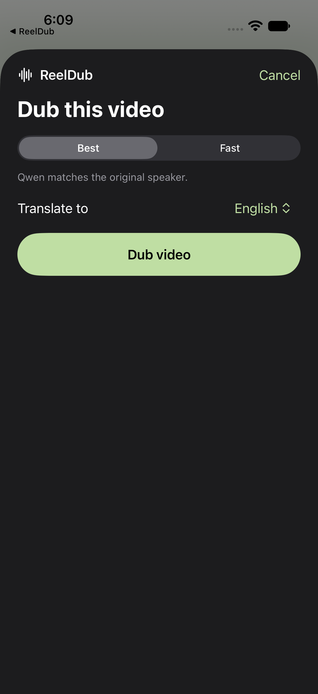

<p align="center"></p>
<h1 align="center">ReelDub</h1>
<p align="center">Share a video link. Hear it in another language, in the speaker’s voice.</p>

ReelDub is a self-hosted video translator with an iPhone share extension and a browser player. Paste a public video link in your browser or share a video link or file from your iPhone. Instagram Reels and YouTube are supported through yt-dlp. Use media and voices you have permission to dub. Your server downloads the source, translates the dialogue, matches the voices and returns a captioned MP4. A connection key is all you need to use the server.

[Quick start](#quick-start) · [Connect your iPhone](#connect-your-iphone) · [Voice modes](#voice-modes) · [Hosting guide](HOSTING.md)

## Quick start

Run the following **on the GPU server**. The packaged renderer uses **Linux x86-64, an NVIDIA GPU, Docker Engine with Compose v2.30+ and the NVIDIA Container Toolkit**. The reference machine has a 16 GB RTX 4070 Ti SUPER and driver 575.57.08. Allow about **60 GB of free space** for environments, weights, installation caches and the first render. Models are downloaded on first install. [NVIDIA Docker setup](https://docs.nvidia.com/datacenter/cloud-native/container-toolkit/latest/install-guide.html)

Choose the library layout before installing. The default uses one shared key. For a private library per person, use `./start-local.sh --postgres` in the last line and follow [Give people their own libraries](#give-people-their-own-libraries).

```sh
git clone https://github.com/arianizadi/local-reeldub.git
cd local-reeldub
./start-local.sh
```

1. Open **http://127.0.0.1:8300** in a browser on the server. A remote server needs a tunnel or an HTTPS address as described below.
2. Copy the value of **`SELF_HOST_KEY`** from the generated `.env` into ReelDub. Keep this file private. People with this shared key use one library. For separate libraries, choose PostgreSQL when installing.
3. Paste a public video link, choose **Best** or **Fast**, and start the dub. The player shows queue and render progress, then lets you play the result with captions.

The first startup prepares both models and runs a synthetic speaker-match test before the worker takes jobs. To follow installation, run `docker compose logs -f models` in another terminal. To check an installation before downloading models, use `./start-local.sh --check`.

## Give people their own libraries

On a **fresh installation**, start with the PostgreSQL option. It keeps credentials, library metadata and the queue on your server. MongoDB holds video bytes. Each person gets an access key for their own library, and everyone shares the GPU queue.

```sh
./start-local.sh --postgres
./access-key create alex
```

Give Alex the server URL and the key printed by the second command. Store that key in a password manager. To replace a lost key or remove access, use `./access-key rotate alex` or `./access-key revoke alex`. For backup, upgrades and running two instances side by side, see the [PostgreSQL hosting notes](HOSTING.md#local-postgresql).

## Connect your iPhone

**Browser:** Make the API reachable on an HTTPS address you control and open it in Safari. For a quick private connection with Tailscale, join the phone and server to the same tailnet, then run the following on the server. Use the HTTPS URL it prints. [Tailscale Serve guide](https://tailscale.com/kb/1242/tailscale-serve)

```sh
tailscale serve --bg http://127.0.0.1:8300
```

**Native Instagram sharing:** On a Mac with Xcode, clone this repository. Create the private file `ios/Config/LocalSigning.xcconfig` with your Apple development team and a bundle ID you control. Xcode uses these settings for the app, its share extension and their shared Keychain.

```xcconfig
DEVELOPMENT_TEAM = YOUR_TEAM_ID
REELDUB_BUNDLE_ID = com.example.yourname.reeldub
```

Open `ios/ReelDub.xcodeproj`, choose the **ReelDub** scheme and your iPhone, then press **Run**. Complete device pairing or enable Developer Mode if Xcode asks. In **Connect your server**, enter the HTTPS address and connection key.

In Instagram, tap **Share → Share to… → ReelDub**. In YouTube, Safari and other apps, open the iOS share sheet and select **ReelDub**. Choose a mode, then **Dub video**. If ReelDub is hidden, use **More** in the iOS share sheet. The extension submits directly to your server, shows **Submitted**, then dismisses. Return to **Dubs** to check progress and watch the finished video. Share a video file from Photos or Files to process a local copy.

<details>
<summary>Preview the iPhone share sheet</summary>



</details>

## Voice modes

| Mode | Speaker matching | Output languages |
| --- | --- | --- |
| **Best** | Qwen3-TTS 1.7B follows references from the original speakers. | English, Chinese, French, German, Italian, Japanese, Korean, Portuguese, Russian and Spanish |
| **Fast** | KittenTTS 2 1.7B with vLLM matches the speaker in English. ReelDub switches to Best if Kitten is unavailable, fails or the selected language needs Qwen. | English with Kitten, other supported languages with Qwen |

**Fast** is a processing preset. On a 20.5-second Spanish test clip, an earlier hosted configuration took 70 seconds with Kitten and 46 seconds with Qwen. Real time depends on the GPU, model startup, clip and queue. Clear dialogue and several seconds of isolated speech per speaker give both engines a better reference.

## What runs where?

- **Downloader** accepts single public HTTP or HTTPS video links handled by yt-dlp. A dedicated proxy resolves each destination and connects to its verified public address. Source websites can limit access by region, require sign-in, or decline automated downloads. Private networks, authenticated media, DRM, playlists and live streams are outside this workflow. Check the [yt-dlp supported sites](https://github.com/yt-dlp/yt-dlp/blob/master/supportedsites.md).
- **GPU worker** detects and groups the speakers, translates their words, synthesizes the chosen voices and mixes them over the separated music and effects. Download, translation and synthesis require no commercial API credentials. AI models can mistranslate lines or confuse overlapping speakers.
- **API and MongoDB** track the queue and store private media. Matching recent requests can reuse a completed render. On iPhone, **Remove from Library** also frees the downloaded app copy. Videos exported to Photos or Files stay there.

In **Dubs**, use **Move to front** or **Move to back** to reorder waiting jobs. **Cancel** works on a queued or processing dub. Canceled items stay in the library until you remove them. There is no default two-minute duration limit. An operator can set a duration cap, and media size and local resources still limit large jobs.

For updates, recovery, TLS, cache behavior and additional GPUs, see the [hosting guide](HOSTING.md) and [GPU fleet notes](GPU-FLEET.md).

## Command line

The CLI can translate a local file or a public video link without running the web service. On the same supported Linux GPU hardware, install FFmpeg, Git, curl, a C/C++ toolchain, espeak-ng and SoX, then run:

```sh
./setup.sh
./dub 'https://www.instagram.com/reel/SHORTCODE/' --quality best
./dub ./interview.mp4 --quality fast --target-language en -o interview-en.mp4
```

The default output directory is `output/`. `--language` overrides input language detection and `--target-language` sets the spoken and subtitle language. Run `./dub --help` for options.

## License and model credits

ReelDub’s application, web player, iOS client and deployment code are [MIT licensed](LICENSE). The setup downloads model weights separately. Each publisher licenses its own weights.

| Component | Upstream |
| --- | --- |
| Speech recognition | [Whisper](https://github.com/openai/whisper) and [faster-whisper](https://github.com/SYSTRAN/faster-whisper) |
| Local translation | [Index-Translate-9B](https://huggingface.co/IndexTeam/Index-Translate-9B) and [llama.cpp](https://github.com/ggml-org/llama.cpp) |
| Best voice | [Qwen3-TTS Base, Apache 2.0](https://huggingface.co/Qwen/Qwen3-TTS-12Hz-1.7B-Base) |
| Fast voice | Powered by KittenML. Flagship weights use the [Stellon Labs Community License](https://huggingface.co/KittenML/kitten-tts-2/blob/c93cb7c271baa51d9ae8204d5277988906f235a2/LICENSE.md). Review its terms and [commercial registration](https://kittenml.com/license/) before commercial use. The decoder uses [Chatterbox Turbo](https://huggingface.co/ResembleAI/chatterbox-turbo). |
| Speaker identification | [sherpa-onnx](https://github.com/k2-fsa/sherpa-onnx), [pyannote segmentation](https://huggingface.co/pyannote/segmentation-3.0) and [WeSpeaker](https://github.com/wenet-e2e/wespeaker) |
| Dialogue and background | [BandIt v2 weights, CC BY-SA 4.0](https://zenodo.org/records/12701995), [BandIt inference](https://github.com/openmirlab/bandit-infer) and [TorchAudio Hybrid Demucs](https://docs.pytorch.org/audio/2.6/tutorials/hybrid_demucs_tutorial.html) |
| Download and export | [yt-dlp](https://github.com/yt-dlp/yt-dlp) and [FFmpeg](https://ffmpeg.org/) |
